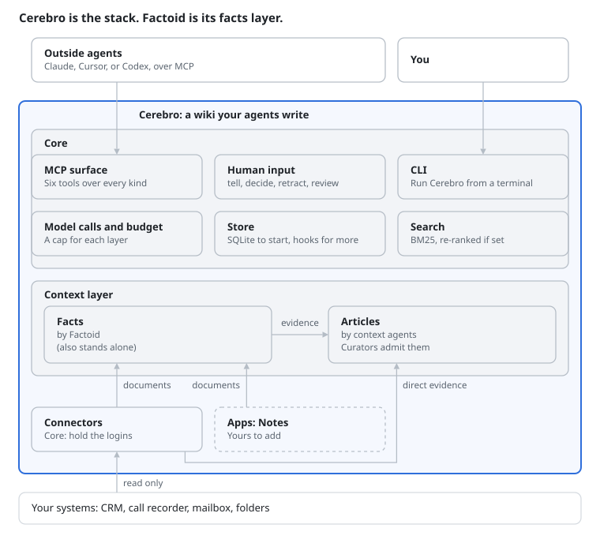

# Cerebro

Cerebro builds a wiki from your sources so your agents give more accurate, consistent answers. It uses [Factoid](https://github.com/Endgame-Labs/factoid) to pull out the facts, writes cited articles from them and keeps the wiki up to date by itself. Agents you write in Markdown do the writing, and the wiki lives in a workspace, a folder of plain files.

<picture>
  <source media="(prefers-color-scheme: dark)" srcset="docs/diagrams/stack.dark.svg">
  
</picture>

## Answers written before anyone asks

Without Cerebro, an agent starts from scratch on every question. It digs through raw call transcripts, documents and email threads, spending time and tokens. Ask again tomorrow, and you might get a different answer.

With Cerebro, the answer's already written, before anyone asks. Everyone gets the same short article, and every sentence cites the fact behind it. It works for any subject your sources cover:

```markdown
---
id: ops/octopus-tank-latch
title: Why the octopus tank has two latches
compiled_at: '2026-11-24T09:12:40Z'
---

Marisol, the giant Pacific octopus in Tank 4, learned to open the single magnetic lid in October. [^fact_mth9me9dm2g5fy81zt0d] Night staff now lock the secondary brass clasp after every 9 p.m. feeding. [^fact_htm9spcdh2zzj2k7y2qf] Dr. Priya Nair approved replacing the lid with a weighted acrylic cover next month. [^fact_eevhyavxy62sn6ps96t9] Don't leave rubber tongs on the catwalk railing, because Marisol can reach them from the top corner. [^fact_k6ps32exkyhzrjsbr617]

[^fact_mth9me9dm2g5fy81zt0d]: AQUA-418, 2 Oct "Found Marisol halfway across the pump room floor at 04:15; she popped the magnetic lid on Tank 4 again."

[^fact_htm9spcdh2zzj2k7y2qf]: docs/night-shift-checklist.md "After the 9 p.m. feeding, fasten the secondary brass clasp on Tank 4 before leaving the gallery."

[^fact_eevhyavxy62sn6ps96t9]: "Tank 4 lid replacement", 12 Nov "I signed off on the weighted acrylic cover for Tank 4; fabrication finishes in December. Thanks, Priya"

[^fact_k6ps32exkyhzrjsbr617]: #kelp-gallery, 19 Nov "Reminder: stop setting rubber tongs on the Tank 4 railing, Marisol grabbed another pair today."
```

Each `[^fact_…]` is a footnote. It names one fact, and the note at the bottom quotes where that fact came from.

## What you control

- A curator's `authority:` line says what it may do on its own, such as add, merge or archive articles. Anything else waits for you in `cerebro review`. See [agents](docs/agents.md).
- Claude Code, Cursor or any MCP client can read the wiki and tell it what changed. See [MCP](docs/mcp.md).
- It's plain Python, so you can add your own [sources](docs/sources.md), [MCP tools](docs/apps/README.md) and more.

## Try it

You need Python 3.13, [uv](https://docs.astral.sh/uv/), a Fireworks key and a Typesafe key.

```sh
git clone https://github.com/Endgame-Labs/cerebro
cd cerebro
uv tool install .
cerebro init ~/wikis/team-wiki
```

`init` asks a few questions, from a template and a daily budget to your model keys, sources and AI tools, then runs a first pass. If it has nothing to read yet, go to the workspace with `cd ~/wikis/team-wiki`. Drop a note in `local/` or connect a source with `cerebro connect`, then run `cerebro serve --once`. The [quickstart](docs/quickstart.md) walks through each step, from your first note to asking your agent about it.

## Status

Cerebro is at 0.1. Before 1.0, an update can change how a workspace is stored. When that happens, Cerebro stops and tells you what to do. It never changes your sources, but what you told it, the decisions you made and what your apps saved don't carry over.

## Docs

Start at [docs/README.md](docs/README.md).

## Develop

Run the tests with `uv sync && uv run pytest` from the base folder. They need no network and no model. CI also lints `src`, `tests`, `checks` and `apps`, and checks the diagrams with `uv run python docs/diagrams/build.py --check`.
